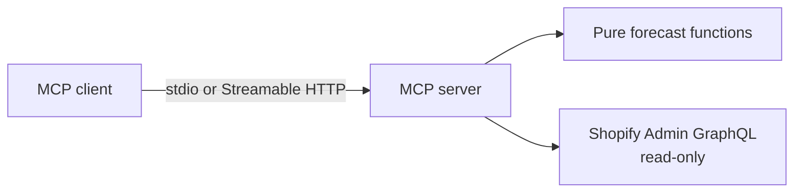

# shopify-inventory-mcp — Deterministic Inventory Forecasts for Any AI Assistant

> **Open-Source (MIT)** | Local stdio BYOK · Hosted HTTP (your Shopify headers) | Not affiliated with Shopify

[](https://github.com/arsalan-arshad/shopify-inventory-mcp/actions/workflows/ci.yml)
[](LICENSE)
[](package.json)

> **Status:** **0.2.3** — four MCP tools over **local stdio (env BYOK)** or **hosted Streamable HTTP**. Hosted `/` serves a README-style page; `/mcp` is the tool endpoint. Users send their own Shopify credentials in headers (no shared Bearer key).

---

## 1. Overview

Merchants ask AI assistants “what will I run out of?” Assistants can read inventory, but guessed reorder numbers are dangerous. This **read-only MCP server** computes weighted moving average demand, days of cover, stockout date, and reorder point from **your** Shopify data and returns structured JSON the model can explain — not invent.

**Two ways:**
1. **Local** — run the server on your machine; Shopify creds in `env` (maximum privacy).
2. **Hosted** — use the public Railway URL; send your Shopify headers only (`X-Shopify-Store-Domain`, client id/secret). See [`docs/HOSTED.md`](docs/HOSTED.md).

**Tool results** are still sent to the model provider by your MCP client either way.

Official Shopify MCP (UCP) covers storefront/cart/checkout — **not** Admin inventory forecasting. That’s the gap this fills.

This is **deterministic forecasting** (weighted moving averages + safety stock), not machine-learning / “AI forecasting.”

---

## 2. Tools (v0)

| Tool | Returns |
|---|---|
| `list_at_risk_skus` | SKUs with days of cover ≤ lead time (`reorder_now`), default limit **50** |
| `get_sku_forecast` | Daily demand, cover, projected stockout for one SKU |
| `get_reorder_suggestion` | Reorder point + safety stock |
| `explain_forecast_inputs` | Formulas, window, caveats (auditable) |

**v0 lead times are store-wide** (env or tool param). **Per-SKU config is v1.**

---

## 3. How the numbers work (example)

SKU `X`: 150 in stock · demand 8/day · lead time 21 days → cover **18.75** → **at risk**; safety stock ≈ **22.7**; reorder point ≈ **190.7**.

Same formulas as Agent Forecast (`forecasting.js`). Defaults: WMA 4 / reorder WMA 14 / z=1.65 / lead 21d. Multi-location: **sum `available`**.

---

## 4. Setup (credentials)

Shopify **no longer allows creating new admin-created custom apps**. Use one of:

### A. Dev Dashboard app (recommended for new setups)

1. Open the [Dev Dashboard](https://shopify.dev/docs/apps/build/dev-dashboard/create-apps-using-dev-dashboard) → **Create app**.
2. Create a **version** with App URL `https://shopify.dev/apps/default-app-home` (fine for API-only) and scopes:
   - `read_inventory`, `read_locations`, `read_orders`, `read_products`
3. **Release** the version, then **Install** on your store.
4. **App settings** → copy **Client ID** and **Client secret**.
5. Copy `.env.example` → `.env` and set:

```bash
SHOPIFY_STORE_DOMAIN=your-store.myshopify.com
SHOPIFY_CLIENT_ID=...
SHOPIFY_CLIENT_SECRET=...
# optional: LEAD_TIME_DAYS=21
```

Tokens from the client-credentials grant last ~**24 hours**; this server refreshes them automatically.

### B. Existing admin-created custom app (legacy)

If you already have one: **Apps → Develop apps → [app] → API credentials** → Admin API access token. Set `SHOPIFY_ADMIN_ACCESS_TOKEN` instead of client ID/secret.

### Order history note

`read_orders` only returns orders from the **last 60 days**. Thin history → weak forecasts. Extending further needs `read_all_orders` (protected access) — optional later, not required for v0.

---

## 5. Local development quickstart

**Prerequisites:** Node.js **≥ 20**, npm, a Shopify store with the scopes above.

```bash
git clone https://github.com/arsalan-arshad/shopify-inventory-mcp.git
cd shopify-inventory-mcp
cp .env.example .env   # then fill in credentials
npm install
npm test
npm run build
npm start              # stdio MCP server (for clients that spawn it)
# MCP_API_KEY=... npm run start:http   # Streamable HTTP on PORT (default 3000)
```

Or after build: `npx shopify-inventory-mcp` (uses the `bin` entry → stdio).

---

## 6. MCP client config

Replace `/absolute/path/to/shopify-inventory-mcp` with the real clone path on your machine (must point at `dist/server.js` after `npm run build`). Prefer putting secrets in the client `env` block or a local `.env` loaded by your process manager — never commit them.

### Cursor

Add to Cursor MCP settings (`.cursor/mcp.json` in the project, or your global Cursor MCP config):

```json
{
  "mcpServers": {
    "shopify-inventory": {
      "command": "node",
      "args": ["/absolute/path/to/shopify-inventory-mcp/dist/server.js"],
      "env": {
        "SHOPIFY_STORE_DOMAIN": "your-store.myshopify.com",
        "SHOPIFY_CLIENT_ID": "your-client-id",
        "SHOPIFY_CLIENT_SECRET": "your-client-secret"
      }
    }
  }
}
```

Legacy static token (if you have one): set `SHOPIFY_ADMIN_ACCESS_TOKEN` instead of client ID/secret.

### Claude Desktop

Edit Claude Desktop’s MCP config (macOS: `~/Library/Application Support/Claude/claude_desktop_config.json`):

```json
{
  "mcpServers": {
    "shopify-inventory": {
      "command": "node",
      "args": ["/absolute/path/to/shopify-inventory-mcp/dist/server.js"],
      "env": {
        "SHOPIFY_STORE_DOMAIN": "your-store.myshopify.com",
        "SHOPIFY_CLIENT_ID": "your-client-id",
        "SHOPIFY_CLIENT_SECRET": "your-client-secret"
      }
    }
  }
}
```

Restart Cursor / Claude Desktop after saving.

### Remote / hosted (Streamable HTTP + your Shopify headers)

```json
{
  "mcpServers": {
    "shopify-inventory": {
      "url": "https://shopify-inventory-mcp-production-e5fd.up.railway.app/mcp",
      "headers": {
        "X-Shopify-Store-Domain": "your-store.myshopify.com",
        "X-Shopify-Client-Id": "your-client-id",
        "X-Shopify-Client-Secret": "your-client-secret"
      }
    }
  }
}
```

Use **your** Dev Dashboard app credentials. No shared API key. Full notes: [`docs/HOSTED.md`](docs/HOSTED.md).

---

## 7. Example prompts

Once the server is connected, try:

- “Which SKUs am I most at risk of stocking out of in the next three weeks?”
- “Show me the forecast for SKU `ABC-123` — daily demand, days of cover, and projected stockout date.”
- “What’s the reorder point and safety stock for SKU `ABC-123` with a 14-day lead time?”
- “Explain how you calculated the forecast for SKU `ABC-123` — which window and formulas?”
- “List at-risk SKUs, limit 20, assuming a 30-day lead time.”

The assistant should call the MCP tools (`list_at_risk_skus`, `get_sku_forecast`, `get_reorder_suggestion`, `explain_forecast_inputs`) rather than inventing numbers.

---

## 8. Verification & test suite

```bash
npm test          # vitest — math fixtures + Shopify layer unit tests
npm run build     # tsc → dist/
```

CI runs the same on every push/PR to `main`. A live end-to-end check against a real store still needs your credentials (not automated in CI).

---

## 9. Architecture

```
src/
  forecast/       # pure math (WMA, days of cover, reorder point) — no I/O
  shopify/        # Admin GraphQL read layer (BYOK or server env)
  tools/          # schemas + handlers
  http/           # Bearer API-key middleware (hosted)
  server.ts       # stdio MCP entry (bin)
  http-server.ts  # Streamable HTTP MCP entry (Railway)
```



---

## 10. Hosted deploy (Railway)

Host the MCP process only. Users pass Shopify creds in headers. No `MCP_API_KEY` / no Shopify secrets required on Railway. Details: **[`docs/HOSTED.md`](docs/HOSTED.md)**.

---

## 11. Roadmap

- [x] **v0:** four tools, local stdio, store-wide lead time, docs, public GitHub repo
- [x] **0.2.0-hosted:** Streamable HTTP + Railway Dockerfile
- [x] **0.2.1 / 0.2.2:** hosted BYOK via `X-Shopify-*` headers (no Bearer gate)
- [ ] **v1:** per-SKU config, CSV export, Reorder Brain tools
- [ ] **Later:** OAuth accounts / billing, directory listing, Salesforce pipeline, bulk ops / `read_all_orders`

---

## 12. Contributing & Security

See [`CONTRIBUTING.md`](CONTRIBUTING.md) and [`SECURITY.md`](SECURITY.md). Contact: **arsalanarshad.dev@gmail.com**.

## 13. License

MIT — see [`LICENSE`](LICENSE). Not affiliated with Shopify Inc.
